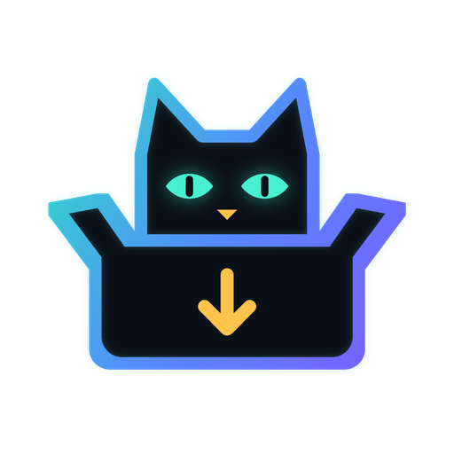

<p align="center"></p>

<h1 align="center">DevCatSKZ Repository</h1>

<p align="center">Alle Kodi-Plugins von DevCatSKZ an einem Ort – mit automatischen Updates.<br>
<i>All Kodi plugins by DevCatSKZ in one place – with automatic updates.</i></p>

<p align="center"><a href="https://github.com/DevCatSKZ/kodi-repo/raw/main/repository.devcatskz.zip"><b>⬇ repository.devcatskz.zip</b></a></p>

---

## Plugins

| Plugin | Beschreibung | Systeme |
|---|---|---|
| **[N-Connect](https://github.com/DevCatSKZ/N-Connect)** (`service.nconnect`) | Nintendo-Switch-2-Controller (Joy-Con 2, Pro Controller 2, GameCube) per Bluetooth – jeder Controller wird ein Xbox-Controller für Kodi, RetroArch und Spiele. Koppelt außerdem Xbox-, PlayStation-, Switch-1- und 8BitDo-Controller automatisch. Vibration, Akku-Warnung, Controller-Tasten für Kodi-Aktionen, 12 Sprachen. | **Selbstständig:** LibreELEC, Batocera, Linux (Raspberry Pi 2–5, 64-Bit-Boxen, PC). **Begleitmodus:** Kodi unter Windows und Android – dort verbindet die N-Connect-App die Controller, das Add-on zeigt Status und Widget (Android: N-Connect für Android ab 0.9.1). macOS: nur Anzeige, keine App. |
| **N-Connect Status** (`plugin.nconnect.status`) | Widget-Quelle für Skins mit dem älteren Pfad `plugin://plugin.nconnect.status/`: zeigt verbundene und bekannte Controller mit Name, Akku, Ladestatus und Spieler-Nr. Jeder Klick öffnet das N-Connect-Hauptmenü. Leitet seit 1.1.0 an `service.nconnect` weiter. | Alle Kodi-Geräte mit `service.nconnect` |
| **N-Connect Bundle Installer** (`script.nconnect.bundle`) | All-in-One-Installer: installiert `service.nconnect` + `plugin.nconnect.status` aus eingebetteten ZIPs (jeweils die beim Bauen aktuelle Version) und richtet im Aeon-Nox-Silvo-Skin automatisch den N-CONNECT-Hauptmenüpunkt mit Controller-Widget ein. Danach Kodi neu starten. | LibreELEC, Batocera, Linux; Windows und Android im Begleitmodus |

**Teststand:** Auf echter Hardware geprüft ist N-Connect bisher nur auf dem Raspberry Pi 4 mit LibreELEC 12.2.1
(Pro Controller 2 und Joy-Con 2). Alle anderen Geräte (Pi 2/3/5, 64-Bit-Boxen, PCs), Batocera, Kodi unter Android
sowie die Kopplung von Xbox-, PlayStation-, Switch-1- und Wii-Controllern sind ungetestet – Rückmeldungen gern als
[Issue](https://github.com/DevCatSKZ/N-Connect/issues). · *Tested on real hardware only on a Raspberry Pi 4 with
LibreELEC 12.2.1; everything else is untested – feedback welcome.*

### N-Connect einzeln herunterladen (ohne Repository) · Single download

| System / Gerät · Device | Datei · File |
|---|---|
| **LibreELEC – alle Geräte (empfohlen)** · all devices (recommended) | [N-Connect-Kodi-LibreELEC-alle-Geraete.zip](https://github.com/DevCatSKZ/kodi-repo/raw/main/downloads/N-Connect-Kodi-LibreELEC-alle-Geraete.zip) |
| LibreELEC – Raspberry Pi 4 / 5, 64-Bit-Boxen (Amlogic, Rockchip …) | [N-Connect-Kodi-LibreELEC-RPi4-RPi5-arm64.zip](https://github.com/DevCatSKZ/kodi-repo/raw/main/downloads/N-Connect-Kodi-LibreELEC-RPi4-RPi5-arm64.zip) |
| LibreELEC – Raspberry Pi 2 / 3 (32 Bit) | [N-Connect-Kodi-LibreELEC-RPi2-RPi3-arm.zip](https://github.com/DevCatSKZ/kodi-repo/raw/main/downloads/N-Connect-Kodi-LibreELEC-RPi2-RPi3-arm.zip) |
| LibreELEC – PC / Mini-PC (Generic, x86_64) | [N-Connect-Kodi-LibreELEC-PC-x86_64.zip](https://github.com/DevCatSKZ/kodi-repo/raw/main/downloads/N-Connect-Kodi-LibreELEC-PC-x86_64.zip) |
| Kodi unter Windows · Kodi on Windows | [N-Connect für Windows](https://github.com/DevCatSKZ/N-Connect/releases/latest) installieren – Kodi erkennt die Controller automatisch; das Add-on zeigt zusätzlich Status und Widget |
| Kodi unter Android · Kodi on Android | N-Connect für Android ab 0.9.1 aus den [Releases](https://github.com/DevCatSKZ/N-Connect/releases) installieren; das Add-on zeigt Status und Widget |

Über das Repository bekommt jedes Gerät automatisch die passende Version. · Via the repository every device gets the right version automatically.

## Installation (Deutsch)

1. Kodi > **Einstellungen > System > Add-ons**: „**Unbekannte Quellen**“ einschalten.
2. Die Repository-ZIP auf das Gerät bringen – **einer** der beiden Wege:
   - **[repository.devcatskz.zip](https://github.com/DevCatSKZ/kodi-repo/raw/main/repository.devcatskz.zip)**
     herunterladen und auf das Gerät kopieren (z. B. per Samba in den Ordner „Downloads“), oder
   - in Kodi unter **Einstellungen > Dateimanager > Quelle hinzufügen** die Adresse
     `https://devcatskz.github.io/kodi-repo/` eintragen (GitHub Pages, Name z. B. „DevCatSKZ“).
3. **Add-ons > Paket-Symbol > Aus ZIP-Datei installieren** > die ZIP aus Schritt 2 wählen (bei der Quelle:
   „DevCatSKZ“ > `repository.devcatskz` > `repository.devcatskz-….zip`).
4. **Add-ons > Paket-Symbol > Aus Repository installieren > DevCatSKZ Repository** > Plugin auswählen > **Installieren**.

Ab jetzt hält Kodi alle Plugins aus diesem Repository automatisch aktuell. Jedes Plugin lässt sich auch einzeln
installieren: Die ZIP-Dateien liegen in den Ordnern dieses Repositorys (z. B. [`service.nconnect/`](service.nconnect/)).

## Installation (English)

1. Kodi > **Settings > System > Add-ons**: enable "**Unknown sources**".
2. Get the repository zip onto the device – **one** of these ways:
   - download **[repository.devcatskz.zip](https://github.com/DevCatSKZ/kodi-repo/raw/main/repository.devcatskz.zip)**
     and copy it to the device (e.g. via Samba into "Downloads"), or
   - add `https://devcatskz.github.io/kodi-repo/` as a source under **Settings > File manager > Add source**
     (GitHub Pages, name it e.g. "DevCatSKZ").
3. **Add-ons > package icon > Install from zip file** > choose the zip from step 2 (with the source: "DevCatSKZ" >
   `repository.devcatskz` > `repository.devcatskz-….zip`).
4. **Add-ons > package icon > Install from repository > DevCatSKZ Repository** > choose a plugin > **Install**.

From now on Kodi keeps all plugins from this repository up to date. Every plugin can also be installed on its own:
the zip files are in the folders of this repository (e.g. [`service.nconnect/`](service.nconnect/)).

## Für Entwickler / For developers

```
<addon-id>/<addon-id>-<version>.zip     Add-on-ZIPs (die zwei neuesten Versionen bleiben erhalten)
addons.xml, addons.xml.md5               Index für Kodi – erzeugt von tools/build_repo.py
index.html (Wurzel und je Ordner)        Verzeichnisliste für die Dateimanager-Quelle über GitHub Pages
repository.devcatskz.zip                 aktuelle Repository-ZIP zum direkten Herunterladen
downloads/                               N-Connect-ZIPs je Gerät unter festem Namen
```

Der Quellcode aller N-Connect-Add-ons liegt im [N-Connect-Repository](https://github.com/DevCatSKZ/N-Connect) unter
`linux/kodi/`. Gebaut und hier abgelegt werden sie mit `linux/build-kodi-addon.ps1 -Repo` – bei einem Release-Tag
erledigt das die CI von N-Connect selbst (Deploy-Key mit Schreibrecht nur auf dieses Repository). Eine Version, die
hier schon liegt, wird nie überschrieben: für ein Update die Version in der `addon.xml` erhöhen.
Andere Plugins: ZIP nach `<addon-id>/` kopieren, `python tools/build_repo.py` ausführen, committen.

Kein offizielles Produkt von Nintendo, Microsoft oder Sony. · Not an official Nintendo, Microsoft or Sony product. · MIT-Lizenz
